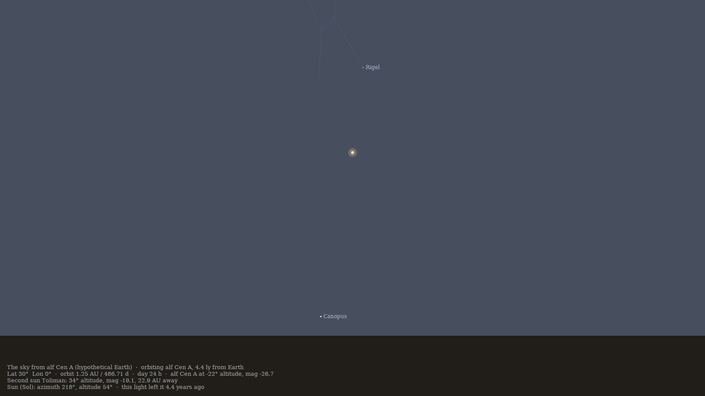

# Design notes

## Architecture

```
AlienSkies.Core        net10.0          astronomy only: catalogs, coordinates, orbit and spin, sky re-projection
   ▲
AlienSkies.Rendering   net10.0          SkyScene (time, tour hops), SaverSettings, SkyRenderer (SkiaSharp)
   ▲
   ├── AlienSkies.Screensaver   net10.0-windows   WinForms .scr host
   ├── AlienSkies.Android       net10.0-android   screen saver, live wallpaper, settings app
   └── tools/AlienSkies.Preview net10.0           renders one frame to PNG, any OS
```

Every host does the same three things: build a `SaverSettings`, wrap it in a `SkyScene`, and each frame hand an `SKCanvas` to `SkyRenderer.Draw`. The renderer knows nothing about the platform beyond a canvas size and a display density (for scaling star sizes, lines and text), so a drawing change shows up identically on every host and can be checked with the Preview tool.

**Windows.** `SkiaSharp.Views.WindowsForms` only ships for .NET Framework, so `SkiaPanel` is a minimal replacement: Skia draws straight into the pixels of a premultiplied-ARGB `System.Drawing.Bitmap`, which WinForms blits to the window. A 33 ms timer drives about 30 frames per second. The `.scr` is a single-file `dotnet publish` of this project, renamed (`publish.ps1`).

**Android.** Three entry points share one `AppSetup.EnsureInitialized`, which plugs the APK's `Assets/data` folder into `CatalogLoader.PlatformSource`:

* `AlienSkiesDream` is a `DreamService` (the system screen saver). It shows a `SkyView`, an `SKCanvasView` that redraws on the display's vsync through `Choreographer`, throttled to about 30 fps.
* `AlienSkiesWallpaper` is the live wallpaper. It draws on the wallpaper `SurfaceHolder` at about 15 fps, only while visible, and spreads 90° of azimuth across the launcher's home-screen pages. Its `WallpaperService.Engine` is a Java shim; see the Android note under known simplifications.
* `SettingsActivity` is the launcher icon, with `PreviewActivity` for a full-screen preview.

**Settings.** `SaverSettings` is a plain class whose properties carry `Category`, `DisplayName` and `Description` attributes. Windows shows it in a `PropertyGrid`; Android builds its settings screen from the same attributes by reflection, hiding the Windows-only multi-monitor panning option. Both save it as JSON, so a new setting appears on both platforms without UI code. The Android project roots `AlienSkies.Core` and `AlienSkies.Rendering` for the trimmer, because that reflection and `System.Text.Json` would otherwise lose properties in a Release build.

**Catalogs.** `CatalogLoader` looks in `<ApplicationData>/AlienSkies/data`, then a `data` folder beside the executable, then the host's `PlatformSource` (Android assets), and finally the small sample embedded in `AlienSkies.Core`.

## Pipeline

1. **Catalog → heliocentric Cartesian (once per catalog load).** RA, Dec, and parallax become an ICRS position in parsecs. Apparent V plus parallax gives absolute magnitude.
2. **Re-centre on the host star (once per planet).** For each star, `rel = star − host`. The direction is `rel/|rel|`, and the new apparent magnitude is `M + 5 log10(|rel|) − 5`. Stars fainter than the limiting magnitude are dropped. Sol is added explicitly so it can be marked.
3. **Planet orbit and spin (every frame).** Only the observer's horizon basis changes between frames. Stellar directions stay fixed because a planetary orbit of a few AU is negligible against parsec distances. That keeps per-frame cost to one dot-product pass over the visible stars.

Every vector stays in ICRS-aligned axes, so no rotation matrices pile up.

### Companion stars (second suns)

Catalog stars within max(0.02 pc, 0.5% of the host distance) of the host position are members of the host's own system. The nearest one is the host itself. The others become `CompanionStar`s instead of fixed stars:

* Their parallaxes are no better than the cross-match slop, so the line-of-sight offset is discarded and only the sky-plane (projected) separation is kept, converted to AU. That is the closest the pair can be, so the companion is never too faint.
* Unlike fixed stars, a companion is re-aimed every frame from the planet's position (`offset − planetOffset`), so a planet's orbit gives it a few degrees of parallax and a small brightness swing.
* The disc size is estimated along the main sequence (R ∝ L^0.2). Daylight comes from whichever sun is brightest above the horizon, so a companion alone in the sky gives a twilight glow.

From the α Cen A sample, Toliman (α Cen B) sits about 24 AU away at magnitude −19, about 300 times brighter than our full Moon:




Reproduce with `dotnet run --project tools/AlienSkies.Preview -- --planet "alf Cen A (hypothetical Earth)" --days 4.75 --az 285 --alt 12` and `--days 237.31 --az 62 --alt 25`.

## Conventions

* **Inclination and ascending node** use exoplanet-archive conventions, measured against the plane of *Earth's* sky. Inclination 0° is face-on to us and 90° is edge-on. That is why the default is 90° rather than 0°: almost every planet with a well-measured inclination was found by transit, so it is nearly edge-on. A consequence is that **our Sun lies close to that planet's ecliptic**, so Sol passes through their zodiac. With an inclination of 0°, Sol would instead sit at their ecliptic pole.
* **The ascending node** is almost never known. It defaults to 0° and only rotates the orbit about our line of sight.
* **Spin:** obliquity tilts the spin pole away from the orbit normal, toward a direction given by "tilt direction" (measured in the orbit plane from the node). With obliquity 0, the planet's celestial pole is its ecliptic pole.
* **Tidal locking:** the rotation period equals the orbital period, phased so that longitude 0 faces the star. Eccentric orbits therefore show real optical libration; the tests see about 0.6° for TRAPPIST-1 e.
* **Azimuth** is measured from the planet's north through east.

## Known simplifications (TODO)

* Proper motion and radial velocity are not yet propagated. That matters for nearby systems and for a "simultaneous" sky.
* Interstellar extinction is ignored, so distant stars look slightly too bright.
* Companion stars are static: they sit at their catalog projected separation and do not follow their binary orbit (α Cen AB: 79.9 yr, 11–36 AU). Circumbinary planets (Kepler-16) would need the planet to orbit the barycentre instead of one star.
* If the host itself is missing from the star catalog, its nearest companion is taken for the host.
* Host luminosity comes from the archive's `sy_vmag`, which is the *system* magnitude and slightly too bright for multiples.
* The B−V colour ramp is approximate. Gaia stars use a rough BP−RP → B−V stand-in.
* The SkiaSharp renderer draws on the CPU. It should handle tens of thousands of visible stars, but a GPU path (Skia's GL backend) is the next step if a full Gaia catalog is used.
* Host-star colour isn't in the exoplanet archive, so it is estimated from absolute magnitude along the main sequence; giant hosts come out too blue.
* Android: `WallpaperService.Engine` is a Java inner class, and the .NET for Android 10 wrapper generator emits an invalid constructor for C# subclasses of inner classes. The Engine therefore lives in a small Java shim (`src/AlienSkies.Android/Java/SkyWallpaperService.java`) that forwards callbacks to C#.

## Roadmap ideas

**Sky realism**
* Binary orbits for companion stars, and circumbinary planets (Kepler-16)
* Sibling planets visible as "wanderers" (in TRAPPIST-1 they would appear larger than our Moon)
* Moons, user-defined
* Atmospheric extinction and airmass dimming near the horizon, plus sky colour from host temperature (red-dwarf daylight)
* Milky Way band from a Gaia density map. It looks nearly the same from anywhere within a few hundred parsecs, which is a lesson in itself.
* Proper-motion epoch slider: the sky from here, 100,000 years from now

**Teaching overlays**
* Earth's constellations, distorted (done: all 88 from Stellarium's modern sky culture; 7 figure stars with no usable Hipparcos parallax, such as β Phe, are skipped)
* "Where is Earth?" marker with distance and light-travel time ("the light you see left the Sun in 1999")
* Local constellations, procedurally drawn by linking each system's own brightest stars
* Highlight the planet's ecliptic, celestial equator, and pole star

**Screen saver UX**
* Tour mode with a cinematic flight between systems (stars stream past)
* Choose systems by filter: habitable zone, within N light-years, transiting only
* "What can they see?" mode: show whether Earth would transit the Sun as seen from that planet
* Per-monitor modes: one panorama, or a different planet on each screen

**Platform**
* GPU rendering (SkiaSharp's GL backend)
* macOS `.saver` reusing the SkiaSharp renderer
* Android: a daylight-aware dim mode for bedside docks
