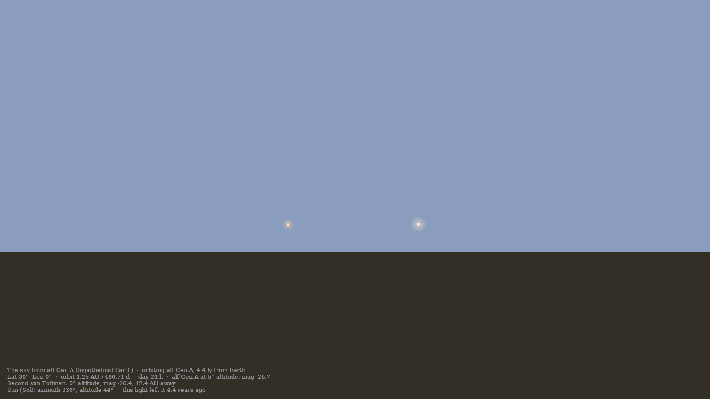
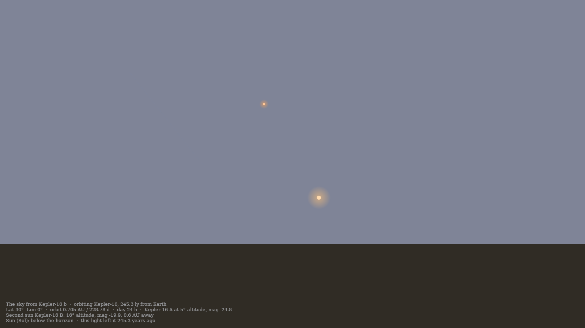
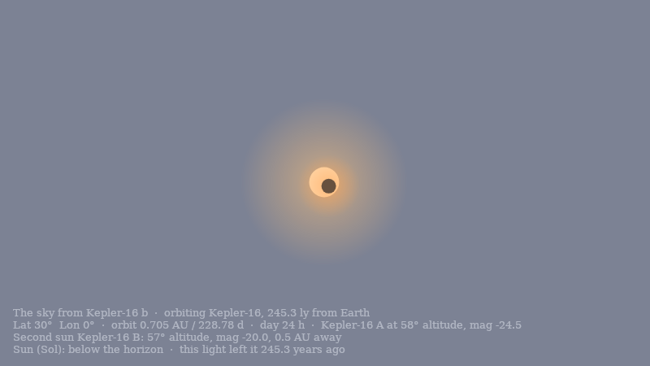

# Design notes

## Architecture

```
AlienSkies.Core        net10.0          astronomy only: catalogs, coordinates, orbit and spin, sky re-projection
   ▲
AlienSkies.Rendering   net10.0          SkyScene (time, tour hops), SaverSettings, SkyRenderer (SkiaSharp)
   ▲
   ├── AlienSkies.Screensaver   net10.0-windows   WinForms .scr host
   ├── AlienSkies.Android       net10.0-android   screen saver, live wallpaper, settings app
   └── tools/AlienSkies.Preview net10.0           renders one frame to PNG, any OS
```

Every host does the same three things: build a `SaverSettings`, wrap it in a `SkyScene`, and each frame hand an `SKCanvas` to `SkyRenderer.Draw`. The renderer knows nothing about the platform beyond a canvas size and a display density (for scaling star sizes, lines and text), so a drawing change shows up identically on every host and can be checked with the Preview tool.

**Windows.** `SkiaSharp.Views.WindowsForms` only ships for .NET Framework, so `SkiaPanel` is a minimal replacement: Skia draws straight into the pixels of a premultiplied-ARGB `System.Drawing.Bitmap`, which WinForms blits to the window. A 33 ms timer drives about 30 frames per second. The `.scr` is a single-file `dotnet publish` of this project, renamed (`publish.ps1`).

**Android.** Three entry points share one `AppSetup.EnsureInitialized`, which plugs the APK's `Assets/data` folder into `CatalogLoader.PlatformSource`:

* `AlienSkiesDream` is a `DreamService` (the system screen saver). It shows a `SkyView`, an `SKCanvasView` that redraws on the display's vsync through `Choreographer`, throttled to about 30 fps.
* `AlienSkiesWallpaper` is the live wallpaper. It draws on the wallpaper `SurfaceHolder` at about 15 fps, only while visible, and spreads 90° of azimuth across the launcher's home-screen pages. Its `WallpaperService.Engine` is a Java shim; see the Android note under known simplifications.
* `SettingsActivity` is the launcher icon, with `PreviewActivity` for a full-screen preview.

**Settings.** `SaverSettings` is a plain class whose properties carry `Category`, `DisplayName` and `Description` attributes. Windows shows it in a `PropertyGrid`; Android builds its settings screen from the same attributes by reflection, hiding the Windows-only multi-monitor panning option. Both save it as JSON, so a new setting appears on both platforms without UI code. The Android project roots `AlienSkies.Core` and `AlienSkies.Rendering` for the trimmer, because that reflection and `System.Text.Json` would otherwise lose properties in a Release build.

**Catalogs.** `CatalogLoader` looks in `<ApplicationData>/AlienSkies/data`, then a `data` folder beside the executable, then the host's `PlatformSource` (Android assets), and finally the small sample embedded in `AlienSkies.Core`.

## Pipeline

1. **Catalog → heliocentric Cartesian (once per catalog load).** RA, Dec, and parallax become an ICRS position in parsecs. Apparent V plus parallax gives absolute magnitude.
2. **Re-centre on the host star (once per planet).** For each star, `rel = star − host`. The direction is `rel/|rel|`, and the new apparent magnitude is `M + 5 log10(|rel|) − 5`. Stars fainter than the limiting magnitude are dropped. Sol is added explicitly so it can be marked.
3. **Planet orbit and spin (every frame).** Only the observer's horizon basis changes between frames. Stellar directions stay fixed because a planetary orbit of a few AU is negligible against parsec distances. That keeps per-frame cost to one dot-product pass over the visible stars.

Every vector stays in ICRS-aligned axes, so no rotation matrices pile up.

### Companion stars (second suns)

Catalog stars within max(0.02 pc, 0.5% of the host distance) of the host position are members of the host's own system. The nearest one is the host itself. The others become `CompanionStar`s instead of fixed stars, and each one moves along a binary orbit (`BinaryOrbit`):

* **Measured orbits** come from `KnownBinaries`, keyed by catalog id. α Cen B uses Pourbaix & Boyajian (2016): P = 79.91 yr, a = 17.66″ (23.6 AU at the catalog parallax), e = 0.524, i = 79.3°, Ω = 205.1°, ω = 232.3°, periastron 1875.66 + n·P. The tests check it against the sample catalog (B 17.8″ from A at PA 216° in 1991.25), against the ~4″ the pair closed to in 2016, and against Kepler's third law with 2.04 M☉.
* **Unmeasured pairs** get a stand-in: a circular orbit, face-on to Earth, with the catalog's projected separation as its radius and the period Kepler's third law gives for both stars' estimated masses. The pair's parallaxes are no better than the cross-match slop, so the line-of-sight offset is discarded; face-on keeps the pair exactly as far apart as the catalog shows them at every moment, and the companion sits at its catalog position at the catalog epoch (J1991.25).
* Elements use the visual-binary (Thiele–Innes) convention, measured on Earth's sky like the planets' elements: x north, y east, z away from Earth; the ascending node is where the secondary recedes.
* Every frame the companion is re-aimed from the planet's position (`offset(t) − planetOffset(t)`), so it shows both its own orbital motion and a few degrees of parallax from the planet's year.
* The disc size is measured where known and otherwise estimated along the main sequence (R ∝ L^0.2). Daylight comes from whichever sun is brightest above the horizon, so a companion alone in the sky gives a twilight glow.

The simulation clock's day 0 is **J2000.0** for binary orbits; `--year` in the Preview tool converts a calendar date. From the α Cen A sample, Toliman sweeps from 36 AU (1995, magnitude −18) in to 11.2 AU at periastron in 2035 (magnitude −20.5, ten times brighter, and visibly a disc):




Reproduce with `dotnet run --project tools/AlienSkies.Preview -- --planet "alf Cen A (hypothetical Earth)" --days 12955.352 --az 255 --alt 10` and `--days 9700 --az 238 --alt 25`.

### Circumbinary planets (two suns, one orbit)

Some planets orbit both stars of a close pair: Kepler-16 b, Kepler-47 c, TOI-1338 b. The exoplanet archive flags them but doesn't describe the pair, so `KnownBinaries` carries each pair's masses, radii, colours, V-band light split and orbit from the discovery papers. When a planet's host name matches (`Kepler-16` or `Kepler-16 AB`):

* The planet's orbit is around the pair's **barycentre**, and Kepler's third law uses both masses (`ExoplanetSystem.CentralMassSolar`): 0.89 M☉ gives Kepler-16 b's measured 228.8 days, where star A alone would give 260.
* Star A sits at `−M_B/M · r(t)` and star B at `+M_A/M · r(t)` from the barycentre, where `r(t)` is the relative orbit. `AlienSky.HostOffsetAu(t)` and the companion's `OffsetAu(t)` give both.
* The archive's `sy_vmag` is the pair's combined light; it is split between the stars by their light fractions, so the two add back up to the catalog magnitude.
* Transit-found pairs and planets are both nearly edge-on to us, and the unmeasurable ascending nodes default to 0° for both, so they come out as nearly coplanar as measured (Kepler-16: within 0.3°). That means **the suns eclipse each other** as seen from the planet, at every conjunction.

`AlienSky.SunsFromPlanet(planetOffset, t)` returns every sun as seen from the planet, host first. Where a nearer disc overlaps a farther one, the farther sun is dimmed by the covered share of its disc (uniform discs, no limb darkening), and the renderer draws nearer suns on top, with a cool star crossing a hotter one drawn dark.





Reproduce with `--planet "Kepler-16 b" --days 10.775 --az 264 --alt 9 --fov 60` and `--days 7.57 --az 205 --alt 57.5 --fov 6 --width 800 --height 450`.

## Conventions

* **Inclination and ascending node** use exoplanet-archive conventions, measured against the plane of *Earth's* sky. Inclination 0° is face-on to us and 90° is edge-on. That is why the default is 90° rather than 0°: almost every planet with a well-measured inclination was found by transit, so it is nearly edge-on. A consequence is that **our Sun lies close to that planet's ecliptic**, so Sol passes through their zodiac. With an inclination of 0°, Sol would instead sit at their ecliptic pole.
* **The ascending node** is almost never known. It defaults to 0° and only rotates the orbit about our line of sight.
* **Spin:** obliquity tilts the spin pole away from the orbit normal, toward a direction given by "tilt direction" (measured in the orbit plane from the node). With obliquity 0, the planet's celestial pole is its ecliptic pole.
* **Tidal locking:** the rotation period equals the orbital period, phased so that longitude 0 faces the star. Eccentric orbits therefore show real optical libration; the tests see about 0.6° for TRAPPIST-1 e.
* **Azimuth** is measured from the planet's north through east.

## Known simplifications (TODO)

* Proper motion and radial velocity are not yet propagated. That matters for nearby systems and for a "simultaneous" sky.
* Interstellar extinction is ignored, so distant stars look slightly too bright.
* Only α Cen AB has a measured binary orbit so far; other catalog companions circle face-on at their projected separation. Circumbinary systems are limited to those in `KnownBinaries` (Kepler-16, Kepler-47, TOI-1338); others in a full archive build are treated as single stars.
* Binary and planet orbits are fixed Kepler ellipses. Real circumbinary planets precess and their orbits wobble with the pair, which this ignores.
* The host star itself stays at the centre of an S-type planet's orbit: the planet's motion with its host around the binary barycentre doesn't change what it sees.
* If the host itself is missing from the star catalog, its nearest companion is taken for the host.
* Host luminosity comes from the archive's `sy_vmag`, which is the *system* magnitude and slightly too bright for multiples (except circumbinary hosts, where it is split between the two stars).
* The B−V colour ramp is approximate. Gaia stars use a rough BP−RP → B−V stand-in.
* The SkiaSharp renderer draws on the CPU. It should handle tens of thousands of visible stars, but a GPU path (Skia's GL backend) is the next step if a full Gaia catalog is used.
* Host-star colour isn't in the exoplanet archive, so it is estimated from absolute magnitude along the main sequence; giant hosts come out too blue.
* Android: `WallpaperService.Engine` is a Java inner class, and the .NET for Android 10 wrapper generator emits an invalid constructor for C# subclasses of inner classes. The Engine therefore lives in a small Java shim (`src/AlienSkies.Android/Java/SkyWallpaperService.java`) that forwards callbacks to C#.

## Roadmap ideas

**Sky realism**
* Sibling planets visible as "wanderers" (in TRAPPIST-1 they would appear larger than our Moon)
* Moons, user-defined
* Atmospheric extinction and airmass dimming near the horizon, plus sky colour from host temperature (red-dwarf daylight)
* Milky Way band from a Gaia density map. It looks nearly the same from anywhere within a few hundred parsecs, which is a lesson in itself.
* Proper-motion epoch slider: the sky from here, 100,000 years from now

**Teaching overlays**
* Earth's constellations, distorted (done: all 88 from Stellarium's modern sky culture; 7 figure stars with no usable Hipparcos parallax, such as β Phe, are skipped)
* "Where is Earth?" marker with distance and light-travel time ("the light you see left the Sun in 1999")
* Local constellations, procedurally drawn by linking each system's own brightest stars
* Highlight the planet's ecliptic, celestial equator, and pole star

**Screen saver UX**
* Tour mode with a cinematic flight between systems (done: `Core/Travel` re-projects every star from the moving viewpoint; see below)
* Choose systems by filter: habitable zone, within N light-years, transiting only
* "What can they see?" mode: show whether Earth would transit the Sun as seen from that planet
* Per-monitor modes: one panorama, or a different planet on each screen

**Platform**
* GPU rendering (SkiaSharp's GL backend)
* macOS `.saver` reusing the SkiaSharp renderer
* Android: a daylight-aware dim mode for bedside docks

## Flights between systems

Tour mode can fly to each new planet instead of cutting to it (`TourFlights`, on by default). The pieces:

* `Core/Travel/FlightTimeline` is pure timing over progress u ∈ [0, 1]: lift-off (the surface dissolves), turn-out (the
  camera swings to face the destination), cruise (smooth start and stop along a straight line), turn-in, landing. Every
  curve is continuous, and the viewpoint never moves while the ground is visible or the camera is turning.
* `Core/Travel/FlightSky` holds the catalog plus both hosts, their companions and Sol as positions, and re-projects all of
  them for any viewpoint each frame (direction and inverse-square brightness). The optional near-light-speed look adds
  relativistic aberration and a Doppler tint, at a purely visual top speed of 0.6 c.
* `Rendering/TourFlight` holds the departure and arrival scenes (sharing the tour's clock, so both skies keep turning)
  and the progress; `SkyScene.Tick` advances it and swaps in the arrival planet on landing.
* `SkyRenderer.Flight.cs` draws it. At both ends the flight camera equals the surface camera and `FlightSky` agrees with
  that planet's `AlienSky`, so the surface view is simply drawn on top at the dissolve's opacity, with no jump.

`tools/AlienSkies.Preview --to <planet> --frames N` renders a flight as a numbered frame sequence, and CI uploads one.
